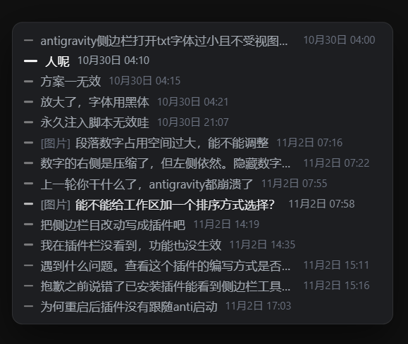
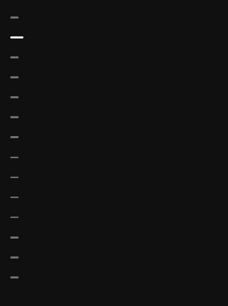

# Antigravity Turn Navigator · 轮次侧边栏

给 Antigravity 加一条右侧的**轮次导航 rail**：把当前会话里每一条用户提问列成一列，点击任意一条直接跳到对应轮次，滚动时自动高亮当前所在的那一轮。

长对话（上百轮）里手动往上翻找某句话非常痛苦，这个插件就是解决这件事的。

<table>
  <tr>
    <td align="center"><br><sub>展开态 · 悬停/点击展开，每轮文字 + 日期</sub></td>
    <td align="center"><br><sub>收起态 · 只留进度条，高亮跟随滚动</sub></td>
  </tr>
</table>

## 特性

- **每轮一行**：显示该轮提问的首行文字（超长省略），回复里带图片的标 `[图片]` 前缀
- **点击跳转**：平滑缓动滚到目标轮次，落到视口顶部（留 8px 呼吸位）
- **滚动高亮**：手动滚动时，主动画跟随当前视口内的轮次，多出 30% 参考线判定
- **自动居中**：高亮行自动滚到 rail 中部；首尾两条不强行居中，直接夹边
- **日期灰显**：展开时在末尾显示 `10月19日 23:11`（省年份，窄条里没意义）
- **常驻全量**：会话内轮次一次性挂载后常驻，切换会话才重建，避免历史忽长忽短
- **不碰 app.asar**：走 CDP 注入 widget，Antigravity 升级只需重开插件，不用重打包

## 安装

把本仓库整个目录放到 Antigravity 的插件目录下：

```
~/.gemini/config/plugins/turn-nav/          # macOS / Linux
%USERPROFILE%\.gemini\config\plugins\turn-nav\   # Windows
```

目录结构：

```
turn-nav/
├── plugin.json                 # 插件清单（name / display_name / version / logo）
├── assets/logo.svg
└── sidecars/panel/
    ├── sidecar.json            # sidecar 定义：command / args / restart_policy
    ├── main.mjs                # 入口：读 widget 源码 → 启动注入 + 面板 http 服务
    ├── turn-core.mjs           # CDP 连接、target 发现、SQLite 轮次读取
    └── turns-widget.js         # 注入到页面的 widget（Shadow DOM 隔离）
```

然后重启 Antigravity，在插件面板里打开「轮次侧边栏」。

## 原理

```
Antigravity main (Electron)
  └─> language_server.exe --standalone --enable_sidecars
        └─> 按 sidecar.json 拉起插件：Antigravity.exe --import=.../register_loader.js main.mjs
              ├─ 轮询 %APPDATA%/Antigravity/DevToolsActivePort 拿到渲染进程调试端口
              ├─ GET /json/list → 找到 ws://127.0.0.1:<port>/devtools/page/<id>
              ├─ Page.addScriptToEvaluateOnNewDocument(widgetSource) + Runtime.evaluate(widgetSource)
              └─ Runtime.addBinding('__agTurnBridge') ← widget 通过它要会话轮次数据
```

- **轮次文本**：从会话 SQLite 库 `~/.gemini/antigravity/conversations/<uuid>.db` 的 `steps` 表读（`step_type = 14` 即用户输入），不依赖页面 DOM 里有没有渲染出来。
- **轮次身份**：页面上每个 `[data-testid="user-input-step"]` 元素的 React fiber 上有 `userStepIndex`（会话内的绝对步索引），拿它做稳定主键，所以同内容的多条提问不会串。
- **全量挂载**：通过 fiber 找到 conversation 的 `agentStateProvider`，调 `requestPageUpdate({ startStepIndex: 0, endStepIndex: total })` 让虚拟列表把所有轮次挂上 DOM，一次性拿到全量列表。
- **注入版本**：`turns-widget.js` 顶部的 `const VERSION` 变化时，sidecar 会在下一个 tick 自动重注入；改样式只需改文件，不用重启。

## 已知限制

- 只支持 Antigravity 桌面版（依赖它自己开着的 CDP 调试端口）
- 注入脚本随 Antigravity 内部 DOM 结构变化可能需要跟进维护
- `node:sqlite` 需要 Node 22.5+（Antigravity 自带运行时满足）

## License

MIT
